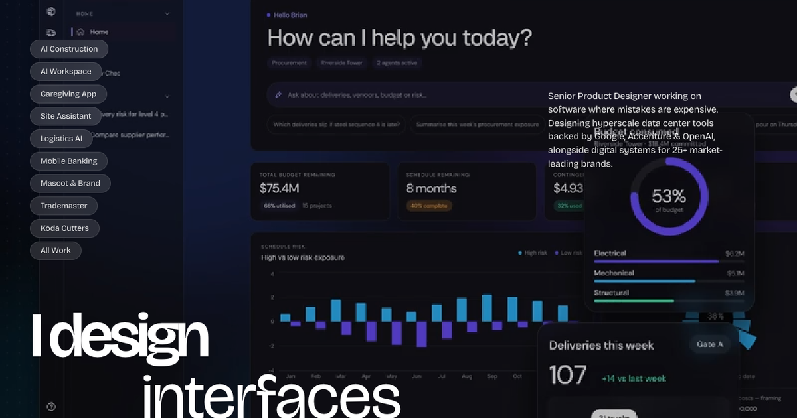

# Brian Ragaza: Senior Product Designer Portfolio



An editorial, high-performance portfolio website built for **Brian Ragaza**, Senior Product Designer (UX/UI) specializing in mission-critical software, B2B SaaS, AI Workspaces, and brand design systems.

## ✨ Highlights & Architecture

- **Zero-Dependency Stack**: Built with pure semantic HTML5, modern CSS3, and vanilla JavaScript for instant loading, zero build steps, and maximum reliability.
- **Typography**: System typography using **Bricolage Grotesque** with semibold headers (`font-weight: 600`, tight negative tracking `-0.06em`) and regular body (`font-weight: 400`).
- **Responsive Branding**: Centered navigation branding featuring a single-line wordmark for desktop and tablet screens, seamlessly adapting to a custom two-line mark for mobile devices.
- **Studio Clock**: Real-time studio time for Manila (`MNL` / `Asia/Manila`).
- **Menu Drawer Centerpiece**: Featuring Brian's portrait, verified LinkedIn Top Voice recognition badge, and a smooth rotating impact showcase highlighting engineering backed by Google, Accenture, and OpenAI.
- **Functional Form Dispatch**: Automated inquiry submission routing full project specs directly to `ragazabrian@gmail.com` with dynamic project scope email subjects and mail client fallbacks.
- **Showcase of 25+ Shipped Platforms**: Including AI Construction Workspaces, Frontier AI Interfaces, Mobile Neo-Banking, and luxury digital flagship transformations.

## 🚀 Running Locally

```bash
# Clone the repository
git clone https://github.com/ragazabrian/brian-ragaza-portfolio.git

# Enter project directory
cd brian-ragaza-portfolio

# Start the local Python server
python3 server.py
```

Then visit `http://localhost:8000` in your browser.

## 🌐 Live Deployment

Hosted live on GitHub Pages:
[https://ragazabrian.github.io/brian-ragaza-portfolio/](https://ragazabrian.github.io/brian-ragaza-portfolio/)
